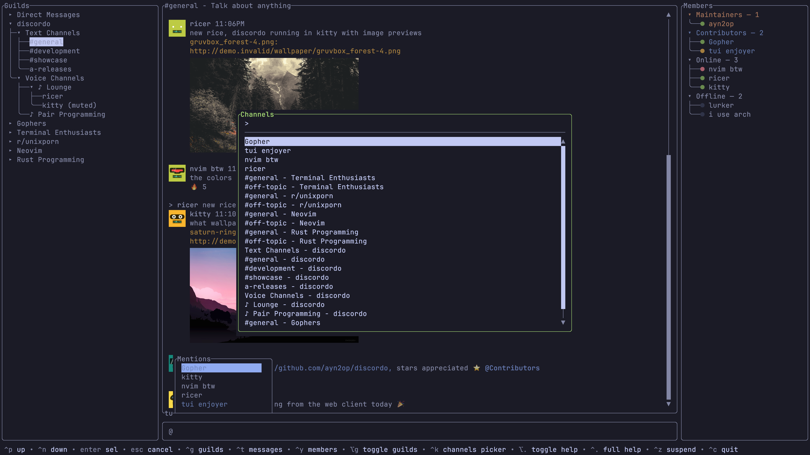

# Discordo &middot; [](https://discord.com/invite/VzF9UFn2aB) [](https://github.com/seamanticus/discordo/blob/master/LICENSE)

Discordo is a lightweight, secure, and feature-rich Discord terminal client.




## Installation

### Prebuilt binaries

You can download and install a [prebuilt binary here](https://nightly.link/seamanticus/discordo/workflows/ci/master) for Linux.

### Package managers

- Arch Linux: `yay -S discordo-git`
- Gentoo (available on the guru repos as a live ebuild): `emerge net-im/discordo`
- FreeBSD: `pkg install discordo` or via the ports system `make -C /usr/ports/net-im/discordo install clean`
- Nix: Add `pkgs.discordo` to `environment.systemPackages` or `home.packages`
- Android (Termux): `pkg install discordo`

- Windows (Scoop):

```sh
scoop bucket add vvxrtues https://github.com/vvirtues/bucket
scoop install discordo
```

### Building from source

Requires [Go](https://go.dev/dl).

```sh
git clone https://github.com/seamanticus/discordo
cd discordo
go build ./cmd/discordo
```

#### Tags

- `no_syntax_highlighting` to build without syntax highlighting in code blocks.

## Usage

### Password (UI)

1. Run the `discordo` executable with no arguments.

2. Open the "Password" tab, enter your email address or E.164-formatted phone number and password, then click the "Login" button.

### QR (UI)

1. Run the `discordo` executable with no arguments.

2. Click on the "Login with QR" button.

3. Follow the instructions in the QR Login screen.

### Token (UI)

1. Run the `discordo` executable with no arguments.

2. Enter your token and click on the "Login" button to save it.

### Stored token

A token from any login is encrypted with `token-encrypt-cmd` and stored in `$XDG_STATE_HOME/discordo/token.gpg` (`~/.local/state/discordo/token.gpg` when unset). At startup, before the screen opens, `token-decrypt-cmd` decrypts it, so gpg can ask for the passphrase in the terminal. The defaults are:

```toml
token-encrypt-cmd = "gpg --encrypt --default-recipient-self"
token-decrypt-cmd = "gpg --decrypt --quiet"
```

Both commands read stdin and write stdout, so any tool that does works, such as `age`. Logging out, or Discord rejecting the token, deletes the file; a token Discord refreshes is written back.

## Configuration

The configuration file allows you to configure and customize the behavior, keybindings, and theme of the application. It is at `$XDG_CONFIG_HOME/discordo/config.toml`, or `$HOME/.config/discordo/config.toml`.

Use `-config-path` to change the path.

Discordo uses the default configuration if a configuration file is not found in the aforementioned path; however, the default configuration file is not written to the path. [The configuration reference can be found here](./docs/config.md).

## Logs

The log file is replaced on each run.

- Unix: `$XDG_CACHE_HOME/discordo/logs.txt` or `$HOME/.cache/discordo/logs.txt`
- Darwin: `$HOME/Library/Caches/discordo/logs.txt`
- Windows: `%LocalAppData%/discordo/logs.txt`

Use `-log-path` to change the path, and `-log-level` (`debug`, `info`, `warn`, or `error`) to set the verbosity of what is logged.

## License

Copyright (C) 2025-present ayn2op

This project is licensed under the GNU General Public License v3.0 (GPL-3.0).
See the [LICENSE](./LICENSE) file for the full license text.

# Disclaimer

> [!IMPORTANT]
> Automated user accounts or "self-bots" are against Discord's Terms of Service. I am not responsible for any loss caused by using "self-bots" or Discordo.
